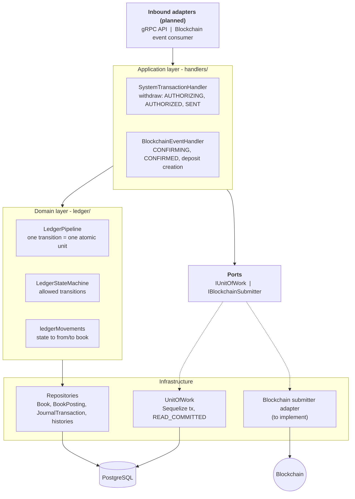
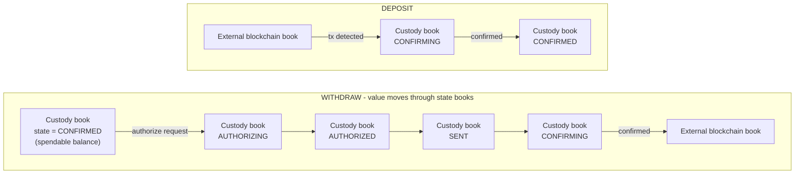
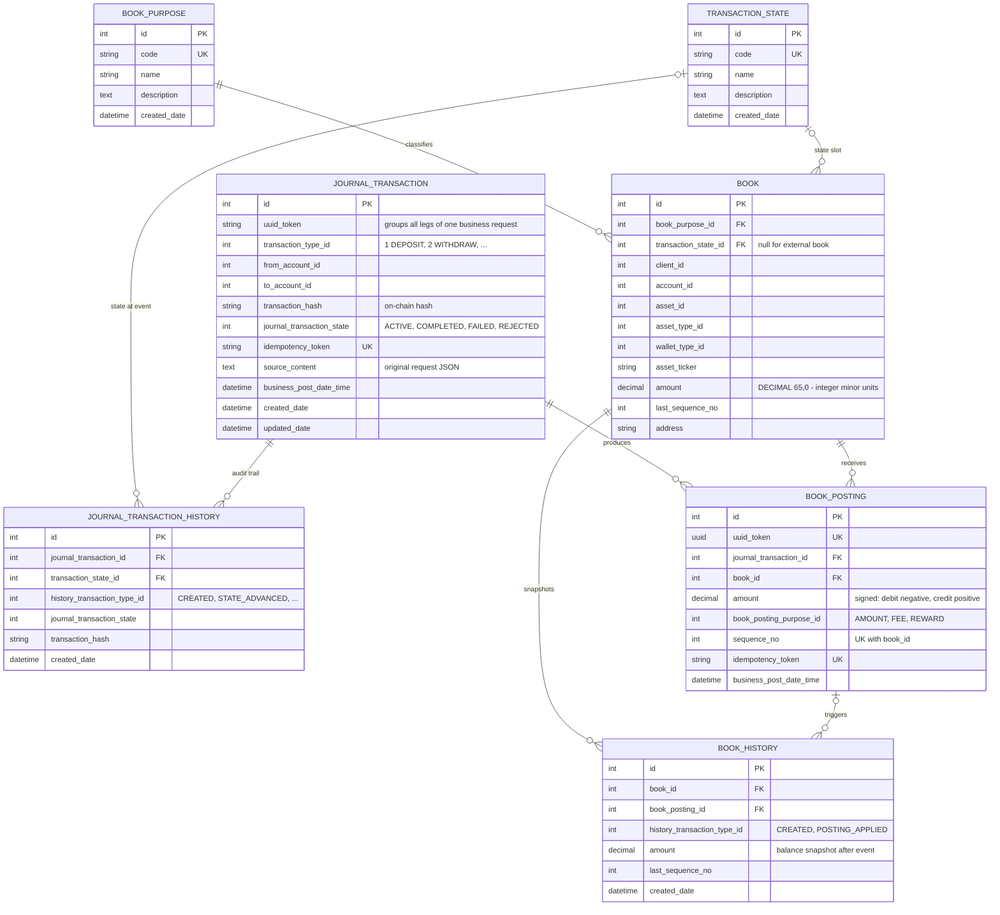
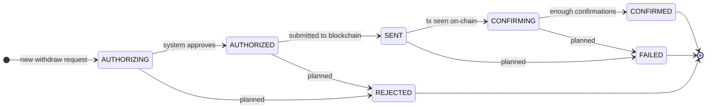
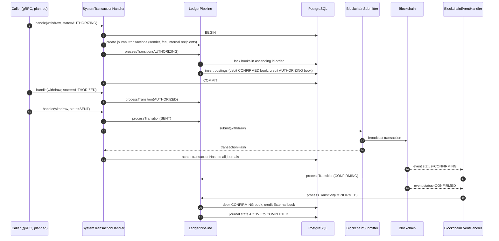
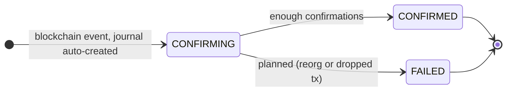
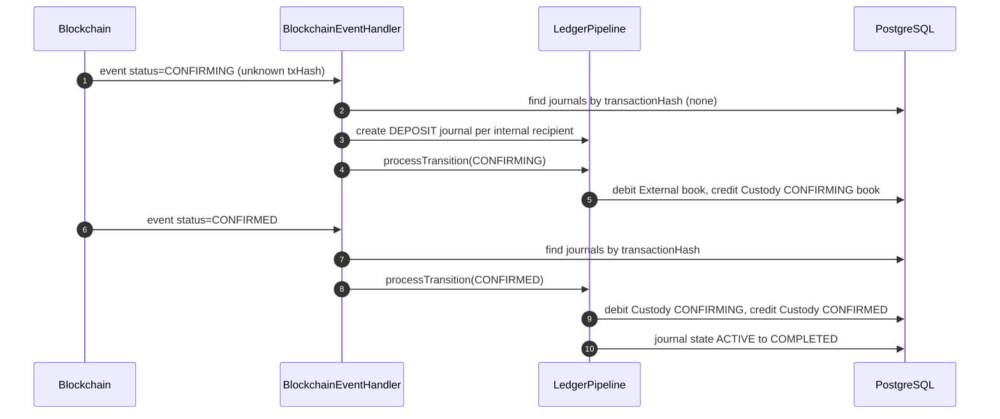

# Custody Bookkeeping Ledger Service

A **double-entry, state-driven ledger** for a crypto custody platform. It records every deposit and withdrawal as a series of balanced postings, tracks each transaction through its blockchain lifecycle, and guarantees correctness under retries and concurrency through idempotency tokens, row-level locking and append-only history.

> **Status:** core ledger engine (deposit + happy-path withdraw) is implemented and exercised by flow scripts. API layer, blockchain adapter, failure paths and staking are on the [roadmap](#roadmap).

---

## Table of contents

1. [Problem & solution](#problem--solution)
2. [Architecture](#architecture)
3. [Core concepts](#core-concepts)
4. [Database design](#database-design)
5. [Transaction lifecycles](#transaction-lifecycles)
6. [Strengths](#strengths)
7. [Known gaps](#known-gaps)
8. [Roadmap](#roadmap)
9. [Getting started](#getting-started)
10. [Project structure](#project-structure)
11. [Diagram sources & images](#diagram-sources--images)

---

## Problem & solution

A custody platform holds client assets on-chain, but clients need a **fast, auditable, internally consistent balance** that does not depend on polling the chain. The hard parts:

| Problem                                                                                                                                      | Solution in this service                                                                                                                                                                                                             |
| -------------------------------------------------------------------------------------------------------------------------------------------- | ------------------------------------------------------------------------------------------------------------------------------------------------------------------------------------------------------------------------------------ |
| A withdraw takes minutes and several steps (authorize, send, confirm) - the user's funds must be neither spendable twice nor lost in between | **State-as-book model**: the same account has one _book_ per transaction state. Funds physically move between books as the transaction advances, so "available", "pending" and "in-flight" amounts are always separate and queryable |
| Messages (API calls, blockchain events) are retried or delivered more than once                                                              | **Idempotency tokens** at the journal level and at every posting; `findOrCreate` semantics                                                                                                                                           |
| Concurrent transactions touching the same balances                                                                                           | **Pessimistic row locks** (`SELECT ... FOR UPDATE`) acquired in **ascending book-id order** to avoid deadlocks; per-book `sequence_no`                                                                                               |
| Need to prove how every balance came to be                                                                                                   | **Append-only** `book_posting`, `book_history` and `journal_transaction_history`                                                                                                                                                     |
| Crypto amounts exceed 64-bit ints                                                                                                            | Amounts are integer strings in minor units, stored as `DECIMAL(65,0)` and computed with `BigInt`                                                                                                                                     |
| Invalid / out-of-order state changes                                                                                                         | Explicit **state machine** per transaction type, validated before any posting is written                                                                                                                                             |

---

## Architecture

The code follows a layered / ports-and-adapters style. Handlers translate external messages into _transition requests_; the **LedgerPipeline** is the only component that writes postings; infrastructure sits behind small ports.



### Layer responsibilities

| Layer          | Folder                                           | Responsibility                                                                                                                                                                                                                                                                                                              |
| -------------- | ------------------------------------------------ | --------------------------------------------------------------------------------------------------------------------------------------------------------------------------------------------------------------------------------------------------------------------------------------------------------------------------- |
| Application    | `handlers/`                                      | `SystemTransactionHandler` drives the outbound (withdraw) states `AUTHORIZING -> AUTHORIZED -> SENT` and calls the blockchain submitter. `BlockchainEventHandler` consumes chain events (`CONFIRMING`, `CONFIRMED`), correlates them to journals by `transactionHash`, and auto-creates deposit journals for unknown hashes |
| Domain         | `ledger/`                                        | `LedgerPipeline` runs one transition: validate -> resolve books -> lock -> write history -> post double entry. `LedgerStateMachine` holds allowed transitions. `ledgerMovements` is the declarative table _(type, target state) -> (from book, to book)_                                                                    |
| Ports          | `ports/`                                         | `IUnitOfWork` (transaction boundary) and `IBlockchainSubmitter` (outbound chain call). Keeps the domain independent of Sequelize and of any node/custodian SDK                                                                                                                                                              |
| Infrastructure | `repositories/`, `models/`, `common/`, `config/` | Sequelize-TypeScript models, repositories, `UnitOfWork`, env-driven config and connection pool                                                                                                                                                                                                                              |
| Cross-cutting  | `helpers/`, `constants/`, `types/`               | Idempotency-token builder, `BigInt` quantity helpers, typed lookup constants                                                                                                                                                                                                                                                |

**Tech stack:** TypeScript, Node.js, PostgreSQL, Sequelize + sequelize-typescript, tsyringe (dependency injection). gRPC settings exist in `config/env.ts` but the server is not yet implemented.

---

## Core concepts

| Concept                 | Meaning                                                                                                                                                                                                                        |
| ----------------------- | ------------------------------------------------------------------------------------------------------------------------------------------------------------------------------------------------------------------------------ |
| **Journal transaction** | One business leg of a request (a sender, a fee payer or an internal recipient). Legs of the same request share a `uuid_token`; each leg has a unique `idempotency_token`. Lifecycle: `ACTIVE -> COMPLETED / FAILED / REJECTED` |
| **Book**                | A balance bucket identified by `(client, account, asset type, wallet type, book purpose, transaction state)`. Two purposes exist: `CUSTODY_ASSET_ACCOUNT` (internal) and `BLOCKCHAIN_EXTERNAL_ACCOUNT` (the outside world)     |
| **Book posting**        | An immutable signed amount applied to one book. A movement always produces **two postings** - negative on the source book, positive on the destination book - so the pair sums to zero                                         |
| **Transaction state**   | `AUTHORIZING (1) -> AUTHORIZED (2) -> SENT (3) -> CONFIRMING (4) -> CONFIRMED (5)`, plus `REJECTED (90)` and `FAILED (91)`                                                                                                     |
| **Movement**            | Declarative rule: moving a withdraw into state _X_ debits book _A_ and credits book _B_                                                                                                                                        |
| **Posting purpose**     | `AMOUNT`, `FEE`, `REWARD` - lets one journal carry transfer and network-fee legs                                                                                                                                               |

### How value moves between books



Example - withdraw of 100 USDT, entering `AUTHORIZING`:

| Book (custody, USDT)  | Posting | Effect                                                                                           |
| --------------------- | ------- | ------------------------------------------------------------------------------------------------ |
| state = `CONFIRMED`   | -100    | spendable balance decreases (rejected with `InsufficientBalanceError` if it would go below zero) |
| state = `AUTHORIZING` | +100    | funds are now reserved and cannot be spent again                                                 |

Posting idempotency token: `{journalIdempotencyToken}-{transactionTypeId}-{targetStateId}-{index}`, so a replayed transition can never double-post.

---

## Database design

Seven PostgreSQL tables. `book_purpose` and `transaction_state` are lookup tables seeded from the constants in code (`scripts/syncDb.ts`).



### Key constraints & indexes

| Table                 | Constraint                                                                                             | Purpose                                                     |
| --------------------- | ------------------------------------------------------------------------------------------------------ | ----------------------------------------------------------- |
| `book`                | unique `(client_id, account_id, asset_type_id, wallet_type_id, book_purpose_id, transaction_state_id)` | one book per slot, enables safe `getOrCreate`               |
| `book_posting`        | unique `(book_id, sequence_no)`                                                                        | gap-free, ordered ledger per book                           |
| `book_posting`        | unique `idempotency_token`, unique `uuid_token`                                                        | exactly-once posting                                        |
| `journal_transaction` | unique `idempotency_token`; indexes on `uuid_token` and `(transaction_hash, request_id)`               | idempotent create, fast lookup by request and by chain hash |

> The book's `amount` is a running balance; `book_history` stores a snapshot after every applied posting, so any historical balance can be reconstructed and reconciled against the sum of postings.

---

## Transaction lifecycles

### Withdraw



> `REJECTED` and `FAILED` are defined in constants but **not yet wired** into the state machine or movements (see [Known gaps](#known-gaps)).



Notes:

- `AUTHORIZING` is idempotent per `uuidToken`: if journals already exist, the call returns `processed: false`.
- Each state transition runs in **its own database transaction**; the blockchain submit happens **outside** a DB transaction, after the `SENT` transition commits.
- A fee paid by a _different_ account than the sender gets its own journal and its own transition requests.

### Deposit





Deposits are **event-driven**: the first `CONFIRMING` event for an unknown `transactionHash` creates one `DEPOSIT` journal per _internal_ recipient. Recipients that have no internal account are ignored.

---

## Strengths

- **Correctness by construction** - every movement is a balanced pair of postings; balances can always be re-derived from postings.
- **Idempotent at every level** - journal tokens, posting tokens, `findOrCreate` everywhere; re-submitting an `AUTHORIZING` request is a no-op.
- **Deadlock-safe concurrency** - books are locked in sorted id order; each posting also re-locks and increments a per-book sequence.
- **No double spend** - funds are _moved_ out of the spendable book at authorization time, and negative balances on the `CONFIRMED` custody book are rejected.
- **Full auditability** - append-only postings plus journal and book history, with the original request JSON preserved in `source_content`.
- **Money-safe arithmetic** - string quantities, `BigInt` math, `DECIMAL(65,0)` storage; quantities validated as positive integers.
- **Declarative, extensible rules** - adding a transaction type is mostly data: new entries in `ENTRY_STATES`, `TRANSITIONS` and `LEDGER_MOVEMENTS`; the pipeline stays unchanged.
- **Testable seams** - blockchain access is a port; flow scripts inject a mock submitter.
- **Operationally tunable** - DB pool size, timeouts, logging and shutdown grace period are env-configured.

---

## Known gaps

Found while reviewing the code. These are real limitations of the current version, listed so they can be prioritised.

| #   | Area                | Gap                                                                                                                                                                                            | Impact                                                                   |
| --- | ------------------- | ---------------------------------------------------------------------------------------------------------------------------------------------------------------------------------------------- | ------------------------------------------------------------------------ |
| 1   | Entry point         | `index.ts` only checks the DB connection; the gRPC server (config exists) and event consumer are not implemented                                                                               | Service cannot receive traffic yet                                       |
| 2   | Failure paths       | `REJECTED` / `FAILED` have no transitions or movements; unsupported cases throw `UnsupportedOperationError` ("happy-path only")                                                                | Reserved funds are never released on failure                             |
| 3   | Replay handling     | Re-delivering the _same_ state (e.g. a duplicate `CONFIRMED` event) throws `InvalidTransitionError` instead of being a no-op; `REJECTED_INVALID_TRANSITION` history event exists but is unused | Consumers must dedupe or will see errors on redelivery                   |
| 4   | Submit atomicity    | Blockchain `submit` and `attachTransactionHash` are not atomic                                                                                                                                 | A crash between them leaves a broadcast tx with no hash on the journal   |
| 5   | Transaction types   | `STAKE`, `UNSTAKE`, `RESTAKE` are typed but not handled                                                                                                                                        | -                                                                        |
| 6   | Blockchain adapter  | `IBlockchainSubmitter` has no real implementation (mocked in tests)                                                                                                                            | Cannot actually send funds                                               |
| 7   | Sender verification | `matchesSender` helper exists but is not applied to incoming events                                                                                                                            | Event-to-journal correlation relies on `transactionHash` and tokens only |
| 8   | Tests               | `test/*.spec.ts` are runnable scripts with no assertions or test framework                                                                                                                     | No regression safety net                                                 |
| 9   | Schema management   | `syncDb.ts` drops tables then `sync()`; `DROP TABLE` has no `IF EXISTS`, so it fails on a fresh DB; no migrations                                                                              | Not safe beyond local dev                                                |
| 10  | Data typing         | Integer primary keys on high-volume tables (`book_posting`, `journal_transaction`)                                                                                                             | Will overflow at very large scale - consider `BIGINT`                    |
| 11  | Naming              | Persisted code `BLOCKCHIAN_EXTERNAL_ACCOUNT` is misspelled (kept to avoid a data migration)                                                                                                    | Cosmetic, needs a planned migration                                      |
| 12  | Observability       | `console.log` only; no structured logging, metrics or tracing                                                                                                                                  | Hard to operate in production                                            |

---

## Roadmap

### Phase 1 - Make it runnable

- [ ] gRPC server: `SubmitSystemTransaction`, query RPCs, health check, graceful shutdown (use `shutdownGracePeriodMs`)
- [ ] Blockchain event consumer (Kafka / SQS / webhook) wired to `BlockchainEventHandler`
- [ ] Real `IBlockchainSubmitter` adapter (custodian / node SDK)
- [ ] Idempotent replay: treat "already at target state" as a successful no-op
- [ ] Replace flow scripts with a real test suite (Jest/Vitest + Testcontainers Postgres) with balance assertions

### Phase 2 - Failure handling & integrity

- [ ] `REJECTED` and `FAILED` transitions with reversal movements that release reserved funds
- [ ] Transactional **outbox** for blockchain submission (fixes the submit/hash gap); retry & dead-letter handling
- [ ] Reconciliation job: `book.amount == SUM(book_posting.amount)`, zero-sum per journal, ledger vs on-chain balances
- [ ] Verify sender address with `matchesSender`; confirmation-depth and reorg handling
- [ ] Versioned migrations (replace `syncDb`), `BIGINT` keys, fix the `BLOCKCHIAN` spelling via migration

### Phase 3 - Features

- [ ] Staking: `STAKE`, `UNSTAKE`, `RESTAKE` movements and pool books; `REWARD` postings
- [ ] Fee model improvements: fee estimation, fee refund / shortfall handling, sweep to treasury accounts
- [ ] Batch withdrawals and multi-asset transfers
- [ ] Deposit address management using `findByDepositAddress`
- [ ] Read API: balances by state, statements, transaction timeline from history tables

### Phase 4 - Production readiness

- [ ] Structured logging, Prometheus metrics, OpenTelemetry tracing
- [ ] Authentication / authorization between services; per-client rate limiting
- [ ] Partitioning / archival for `book_posting` and history tables
- [ ] Dockerfile, CI pipeline, load & concurrency tests
- [ ] Multi-currency valuation and reporting views

---

## Getting started

> Assumptions: `package.json` is not part of the provided sources, so commands below assume `ts-node` and a project root containing this `src/` folder. Adjust paths to your setup.

**Prerequisites:** Node.js 18+, PostgreSQL 14+.

```bash
# 1. Install dependencies (typescript, ts-node, sequelize, sequelize-typescript, pg, tsyringe, reflect-metadata)
npm install

# 2. Configure (defaults shown)
export DB_HOST=localhost
export DB_PORT=5433
export DB_NAME=bookkeeping
export DB_USER=postgres
export DB_PASSWORD=postgres
export DB_LOGGING=false

# 3. Create schema + seed lookup tables  (DESTRUCTIVE: drops all ledger tables)
npx ts-node src/scripts/syncDb.ts

# 4. Run the flow scripts
npx ts-node src/test/deposit.flow.spec.ts
npx ts-node src/test/withdraw.flow.spec.ts
npx ts-node src/test/internal-withdraw.flow.spec.ts
```

### Configuration

| Variable                                 | Default                                 | Description                    |
| ---------------------------------------- | --------------------------------------- | ------------------------------ |
| `DB_HOST` / `DB_PORT`                    | `localhost` / `5433`                    | PostgreSQL address             |
| `DB_NAME` / `DB_USER` / `DB_PASSWORD`    | `bookkeeping` / `postgres` / `postgres` | Credentials                    |
| `DB_LOGGING`                             | `true`                                  | Log SQL statements             |
| `DB_POOL_MAX` / `DB_POOL_MIN`            | `20` / `2`                              | Connection pool bounds         |
| `DB_POOL_ACQUIRE_MS` / `DB_POOL_IDLE_MS` | `30000` / `10000`                       | Pool timeouts                  |
| `GRPC_HOST` / `GRPC_PORT`                | `0.0.0.0` / `50051`                     | Reserved for the gRPC server   |
| `GRPC_MAX_CONCURRENT_STREAMS`            | `200`                                   | Reserved for the gRPC server   |
| `SHUTDOWN_GRACE_PERIOD_MS`               | `10000`                                 | Reserved for graceful shutdown |

### Flow scripts

| Script                           | Scenario                                                                                  |
| -------------------------------- | ----------------------------------------------------------------------------------------- |
| `deposit.flow.spec.ts`           | Deposit to several internal accounts: `CONFIRMING` then `CONFIRMED`                       |
| `withdraw.flow.spec.ts`          | Withdraw to two external addresses, fee paid by the sender's account                      |
| `internal-withdraw.flow.spec.ts` | Withdraw where recipients are internal accounts and the fee is paid by a separate account |

---

## Project structure

```text
src/
├── common/         UnitOfWork, domain errors
├── config/         env, database (Sequelize), DI container
├── constants/      transaction types/states, book purposes, history events
├── handlers/       SystemTransactionHandler, BlockchainEventHandler
├── helpers/        idempotency tokens, quantity (BigInt), book params, correlation
├── ledger/         LedgerPipeline, LedgerStateMachine, ledgerMovements
├── models/         Sequelize-TypeScript entities (7 tables)
├── ports/          IUnitOfWork, IBlockchainSubmitter
├── repositories/   data access with locking and idempotent create
├── scripts/        syncDb (schema + seed)
├── test/           end-to-end flow scripts
├── types/          shared TypeScript types
└── index.ts        bootstrap (DB connection check only)
```

---

## Diagram sources & images

The diagrams above are [Mermaid](https://mermaid.js.org/) blocks, which **GitHub renders natively** inside Markdown - no plugin needed. Pre-rendered images and editable sources live in `docs/diagrams/`:

| Diagram                | Image                                                                                                   | Source                                                |
| ---------------------- | ------------------------------------------------------------------------------------------------------- | ----------------------------------------------------- |
| System architecture    | [PNG](docs/diagrams/01-architecture.png) / [SVG](docs/diagrams/01-architecture.svg)                     | [`.mmd`](docs/diagrams/01-architecture.mmd)           |
| Database ER            | [PNG](docs/diagrams/02-er-diagram.png) / [SVG](docs/diagrams/02-er-diagram.svg)                         | [`.mmd`](docs/diagrams/02-er-diagram.mmd)             |
| Withdraw state machine | [PNG](docs/diagrams/03-withdraw-state-machine.png) / [SVG](docs/diagrams/03-withdraw-state-machine.svg) | [`.mmd`](docs/diagrams/03-withdraw-state-machine.mmd) |
| Deposit state machine  | [PNG](docs/diagrams/04-deposit-state-machine.png) / [SVG](docs/diagrams/04-deposit-state-machine.svg)   | [`.mmd`](docs/diagrams/04-deposit-state-machine.mmd)  |
| Book flow              | [PNG](docs/diagrams/05-book-flow.png) / [SVG](docs/diagrams/05-book-flow.svg)                           | [`.mmd`](docs/diagrams/05-book-flow.mmd)              |
| Withdraw sequence      | [PNG](docs/diagrams/06-withdraw-sequence.png) / [SVG](docs/diagrams/06-withdraw-sequence.svg)           | [`.mmd`](docs/diagrams/06-withdraw-sequence.mmd)      |
| Deposit sequence       | [PNG](docs/diagrams/07-deposit-sequence.png) / [SVG](docs/diagrams/07-deposit-sequence.svg)             | [`.mmd`](docs/diagrams/07-deposit-sequence.mmd)       |

To re-render after editing a `.mmd` file:

```bash
npm i -g @mermaid-js/mermaid-cli
mmdc -i docs/diagrams/02-er-diagram.mmd -o docs/diagrams/02-er-diagram.png -s 2 -b white
```
