# Bookkeeping: Database-Centric Architecture Guide

Bookkeeping is a database-centric, double-entry ledger service for deposits and withdrawals across multiple blockchains. The relational database serves as the source of truth for account balances, transaction states, and immutable ledger records. Transaction processing is driven by database reads and writes, with atomic database transactions enforcing ledger consistency.

The service consumes instructions from internal systems and blockchain events from Kafka, processes them through database-backed transaction flows, and publishes the resulting events back to Kafka.

This document describes the system architecture, transaction lifecycle, data model, and failure-handling mechanisms, with an emphasis on database state transitions, transactional consistency, and recovery flows.

## Design goals

- **Immutable double-entry accounting.** Every balance change is a pair of postings (a debit on a source book, a credit on a destination book). Postings are never updated or deleted.
- **Idempotent at every layer.** However many times a message is delivered, its effect on the ledger happens once.
- **Order independent.** Events that arrive early are parked and applied when the events they depend on arrive.
- **No lost events.** Incoming messages are persisted before they are processed. Outgoing events are persisted in the same transaction as the ledger entries that caused them.
- **Every failure has a defined ending.** Business failures reverse the money, infrastructure failures are retried, and anything that cannot be processed ends up in a dead-letter queue with its context.
- **The core knows nothing about chains.** Chain-specific behavior (account model, UTXO model) is normalized before events reach the ledger.

## System context

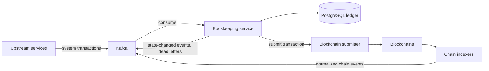

| Kafka topic        | Direction | Content                                                                    |
| ------------------ | --------- | -------------------------------------------------------------------------- |
| System transaction | In        | Instructions from internal systems: one message per state change           |
| Blockchain event   | In        | Normalized events from chain indexers: transaction seen, confirmed, failed |
| State changed      | Out       | One event each time a journal transaction changes state                    |
| Dead letter        | Out       | Everything that could not be processed, with the reason and original data  |

## Architecture

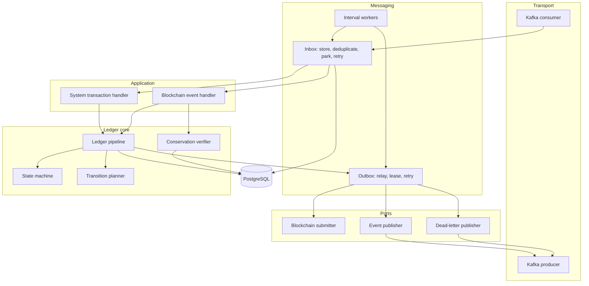

| Layer       | Responsibility                                                                                                                       |
| ----------- | ------------------------------------------------------------------------------------------------------------------------------------ |
| Transport   | Reads messages and writes events. Contains the only code that depends on the Kafka client.                                           |
| Messaging   | Inbox (durable intake, deduplication, ordering tolerance) and outbox (durable output, at-least-once delivery). Workers drive both.   |
| Application | Turns one message into a set of ledger transitions for the journal transactions it concerns.                                         |
| Ledger core | Pure decision logic (state machine, planner) plus the pipeline that locks, writes and reconciles inside one database transaction.    |
| Ports       | Interfaces to things the ledger does not own: submitting to a chain, publishing events, publishing dead letters. Each has a default. |

Three rules hold across the whole system:

- **The inbox is the only way in.** Handlers can only run inside a transaction supplied by the inbox, so no message can bypass deduplication.
- **One message, one transaction.** Applying a message and marking its inbox row as applied commit or roll back together.
- **Decisions are pure, effects are not.** What to post is computed by functions without side effects. Only the pipeline touches the database.

## Core concepts

- **Journal transaction (JT).** One account's participation in a transaction, with its own state and history. A withdrawal creates one JT per sender, one for the fee payer (when it is not a sender) and one deposit-type JT per internal recipient. JTs of the same instruction share a group identifier.
- **Book.** A pot of value for one account, one asset and one state. Custody books hold the customer's money, one per state. The external book is the counterparty that represents the outside world; its balance is negative by the amount that has entered the system.
- **Posting.** One immutable ledger line. Postings come in pairs: negative on the source book, positive on the destination book. Each has a deterministic idempotency token.
- **Holdings.** The net amount a JT currently holds in each book, computed from its postings. This is the source of truth for "where is this transaction's money right now".
- **History.** An append-only record of each JT's state changes. The latest entry is the JT's current state.

### Where the money is

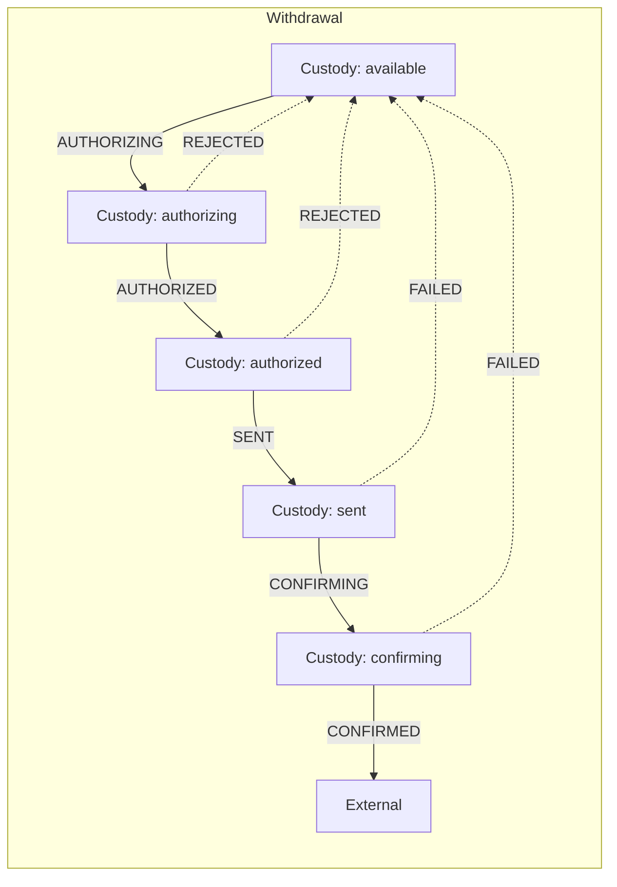

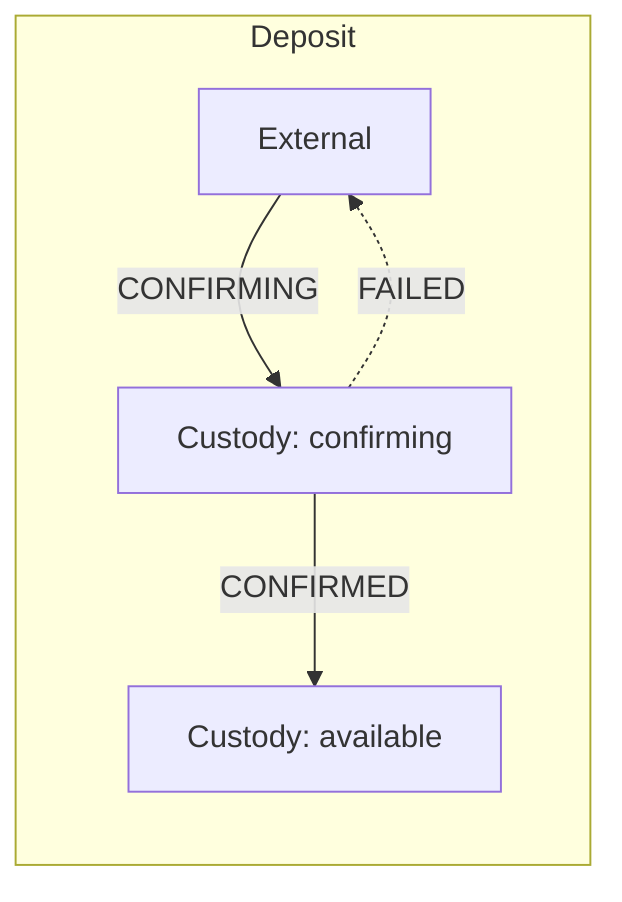

Solid arrows are the forward movements, dotted arrows are the reversals applied on failure. Reversals are never described separately: they are derived from what the JT actually holds, so every transaction type gets them for free.

### State lifecycles

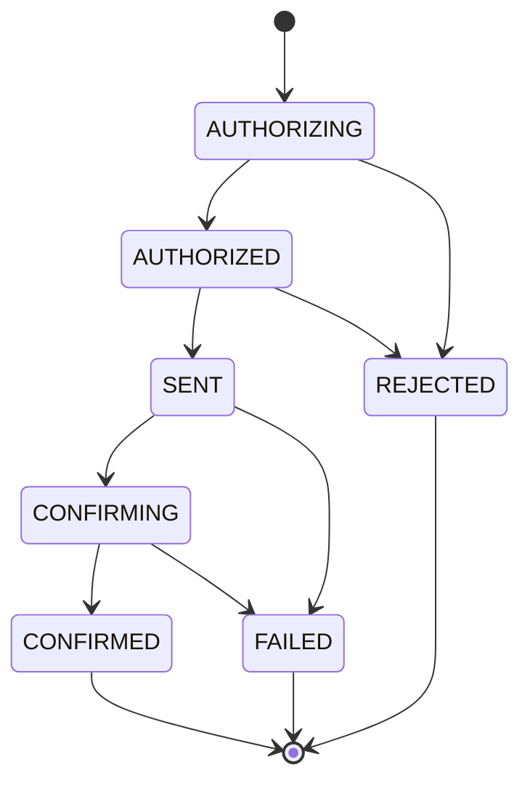

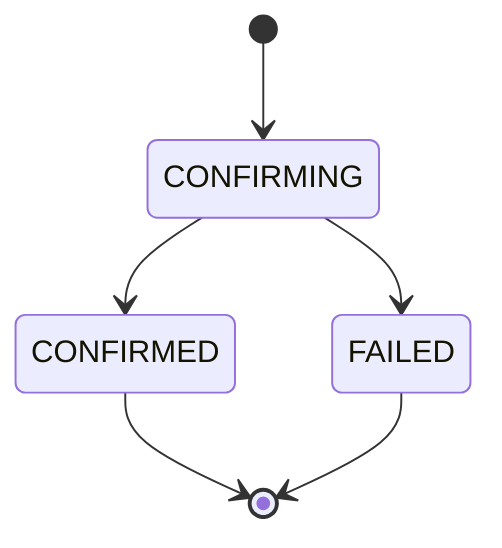

- `REJECTED` is only possible before the transaction is sent. `FAILED` is only possible from the moment it is sent. `CONFIRMED` is final and is never reversed (corrections belong to a separate adjustment process).
- A JT that has not yet received any event (for example the recipient side of an internal withdrawal) has no state. It can still be closed together with the withdrawal.

## Message contract

Every message carries:

- **An event identifier**, unique per message and set by the producer. It is the deduplication key of the entire system.
- **A partition key**: the instruction group identifier for system transactions, the transaction hash for chain events. Messages with the same key stay ordered, but there is no ordering guarantee between the two topics, so the system never relies on it.
- **A payload** that identifies every sender, recipient and fee by a unique token, so that chain events can be matched to journal transactions without ambiguity.

Chain events must be **normalized to the account model** before they reach the ledger: senders are what leaves each account (excluding the fee), recipients are what arrives (excluding change returned to the sender), and the network fee is reported separately. UTXO chains are normalized by the indexer, so adding a chain never changes the ledger.

## Flows

### Deposit

A deposit starts from a chain event. There is no system instruction.

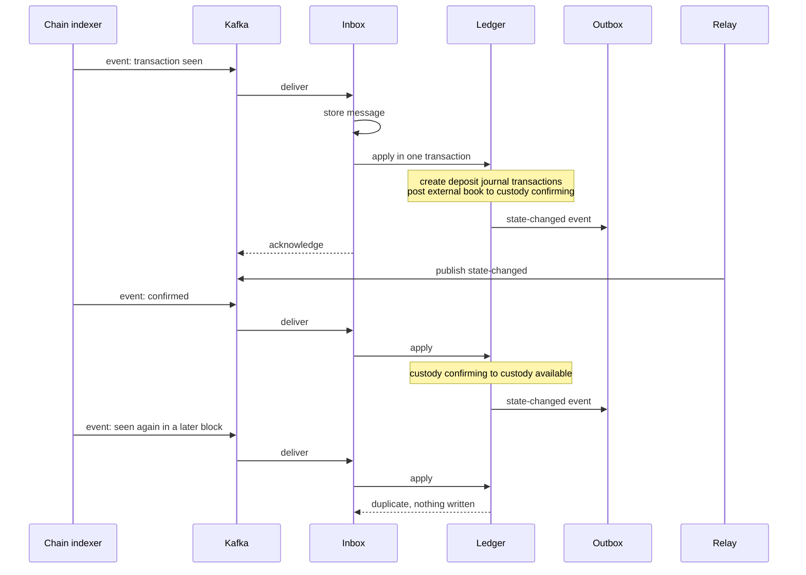

A chain event can belong to a deposit or to a withdrawal the system itself sent, and the two must never be confused (treating a withdrawal as a deposit would credit the recipient twice). The event is resolved like this:

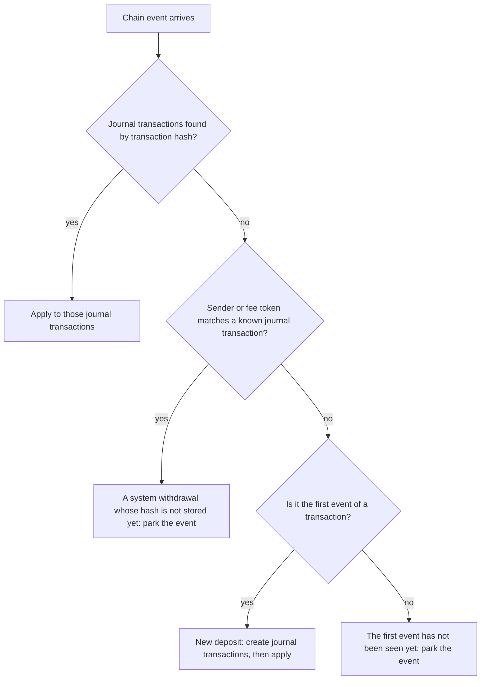

### Withdrawal

A withdrawal is driven by instructions from upstream (one message per state) and completed by events from the chain.

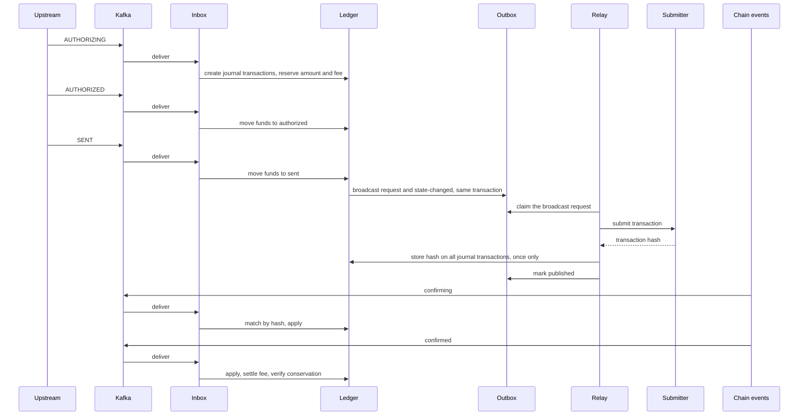

| Step               | What happens in the ledger                                                                                                                       |
| ------------------ | ------------------------------------------------------------------------------------------------------------------------------------------------ |
| AUTHORIZING        | Journal transactions are created. Amount and estimated fee move from the available book to the authorizing book. Insufficient balance aborts.    |
| AUTHORIZED         | Funds move to the authorized book.                                                                                                               |
| SENT               | Funds move to the sent book. A broadcast request is stored in the outbox in the same transaction. Nothing is sent to the chain yet.              |
| Broadcast          | The relay submits the transaction, then stores the hash. The hash is write-once.                                                                 |
| CONFIRMING (chain) | Funds move to the confirming book. Internal recipients receive their funds in the confirming book.                                               |
| CONFIRMED (chain)  | The sender's amount leaves for the external book. The fee is settled. Internal recipients' funds become available. Conservation is then checked. |

Amounts are checked at every step: the amount in a message must equal what the JT holds, and the real fee must not exceed the estimate. Worked example: the sender has 5000 available, the fee payer has 100, the amount is 1000, the estimated fee is 10 and the real fee is 8.

| Step                         | Debit                  | Credit             | Amount               |
| ---------------------------- | ---------------------- | ------------------ | -------------------- |
| AUTHORIZING                  | Sender available       | Sender authorizing | 1000                 |
| AUTHORIZING                  | Payer available        | Payer authorizing  | 10                   |
| AUTHORIZED, SENT, CONFIRMING | Book of previous state | Book of next state | 1000 and 10          |
| CONFIRMED                    | Sender confirming      | External           | 1000                 |
| CONFIRMED                    | Payer confirming       | External           | 8 (real fee)         |
| CONFIRMED                    | Payer confirming       | Payer available    | 2 (unspent estimate) |

Result: the sender ends with 4000 and the fee payer with 92.

## Reliability mechanics

### Consumer behavior

The consumer's only job is to get a message safely into the inbox. After that, success or failure of processing belongs to the inbox.

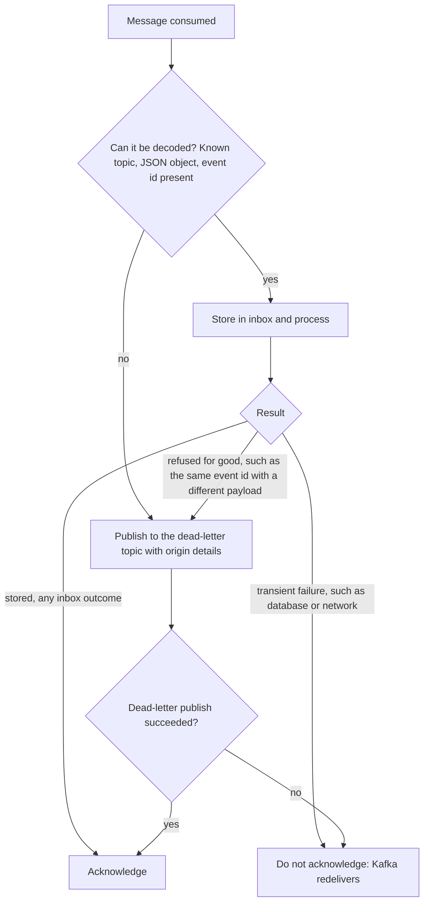

A message is never dropped: the dead-letter write must succeed before the original is acknowledged.

### Inbox

The inbox stores every message once per event identifier, then applies it.

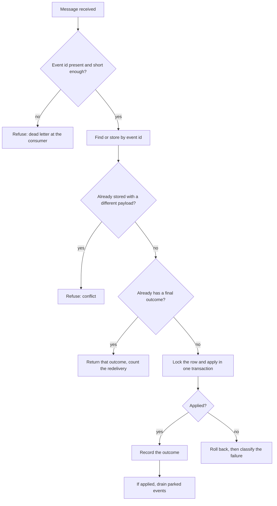

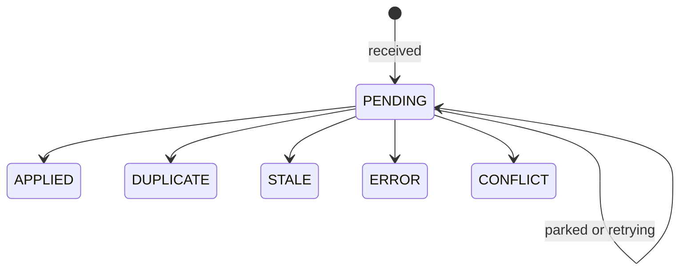

| Status    | Meaning                                                                                |
| --------- | -------------------------------------------------------------------------------------- |
| PENDING   | Stored, not applied yet. Either not processed, parked, or waiting for a retry.         |
| APPLIED   | Written to the ledger.                                                                 |
| DUPLICATE | The target state had already been applied. Nothing written.                            |
| STALE     | The transaction is already past the target state. Nothing written.                     |
| CONFLICT  | The same event id came back with a different payload, or an idempotency or hash clash. |
| ERROR     | Cannot be applied and retrying will not help, or retries ran out.                      |

When applying fails, the transaction is rolled back completely and the failure is recorded in a second transaction:

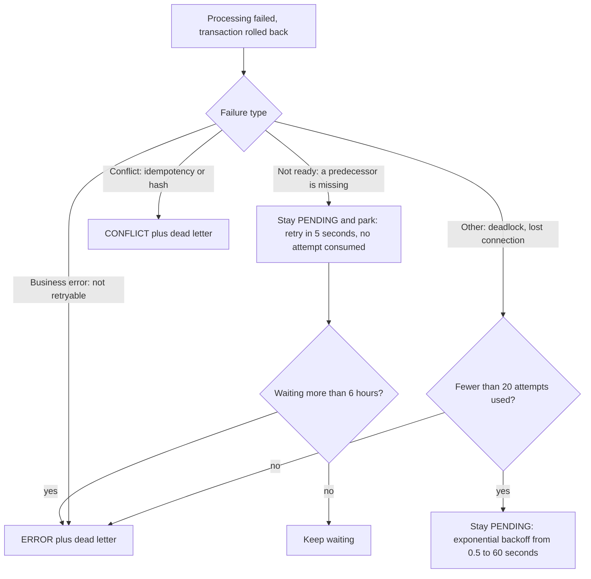

### State machine decisions

For every transition request, the state machine compares the requested state with the JT's current state and returns one of five decisions. It is a pure function.

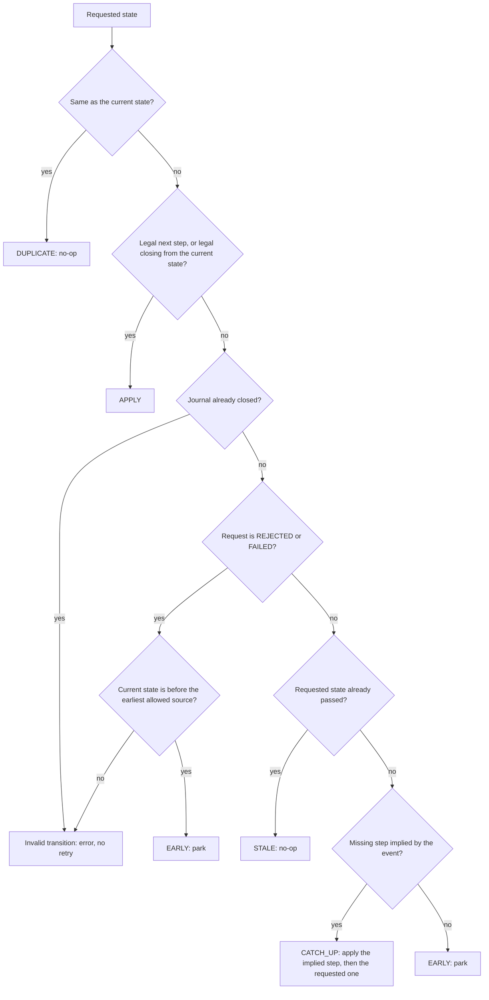

| Decision  | Effect                                                                                                                                                      |
| --------- | ----------------------------------------------------------------------------------------------------------------------------------------------------------- |
| APPLY     | Postings, history and outbox events are written.                                                                                                            |
| CATCH_UP  | "Confirmed" arrived while the JT was still "sent": the implied "confirming" step is applied first, marked as synthetic in history, in the same transaction. |
| DUPLICATE | Nothing is written.                                                                                                                                         |
| STALE     | Nothing is written.                                                                                                                                         |
| EARLY     | A retryable "not ready" error, which the inbox turns into a park.                                                                                           |

Because Kafka gives no ordering across partitions, "confirming" can arrive after "confirmed". Catch-up, parking and stale handling are what make that harmless.

### Park

Parking keeps an event that arrived before its prerequisites instead of rejecting it. A parked event is an inbox row that stays PENDING with the reason recorded.

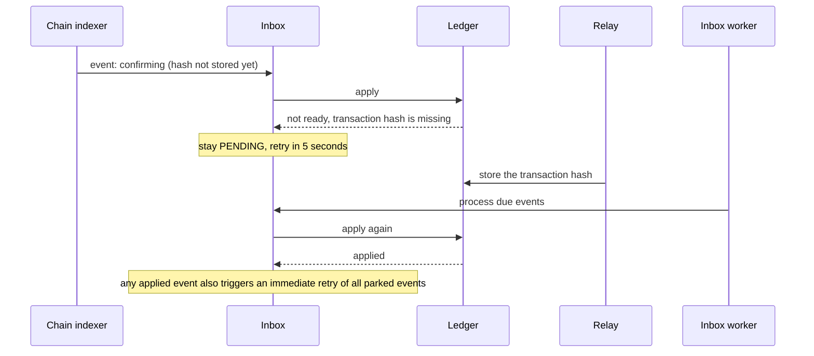

- Parking does not consume retry attempts. Waiting for a predecessor is not a failure.
- Whenever any event is applied, all parked events are retried immediately, ignoring their schedule.
- A parked event that waits longer than 6 hours becomes an error and is dead-lettered.
- Redelivery of a parked event retries it.

### Outbox

The outbox records "work to do after commit" in the same transaction as the ledger entries, so an event can neither be lost nor published for a transaction that rolled back.

| Event type          | Created when                                    | Handled by                                                             |
| ------------------- | ----------------------------------------------- | ---------------------------------------------------------------------- |
| State changed       | A journal transaction changes state             | Published to the state-changed topic, keyed by the journal transaction |
| Broadcast requested | A withdrawal reaches "sent"                     | Submitted to the chain, then the hash is stored                        |
| Dead lettered       | An inbox event or an outbox event ends in error | Published to the dead-letter topic                                     |

Each outbox row is unique per subject, type, state and attempt, so recording the same fact twice produces one row.

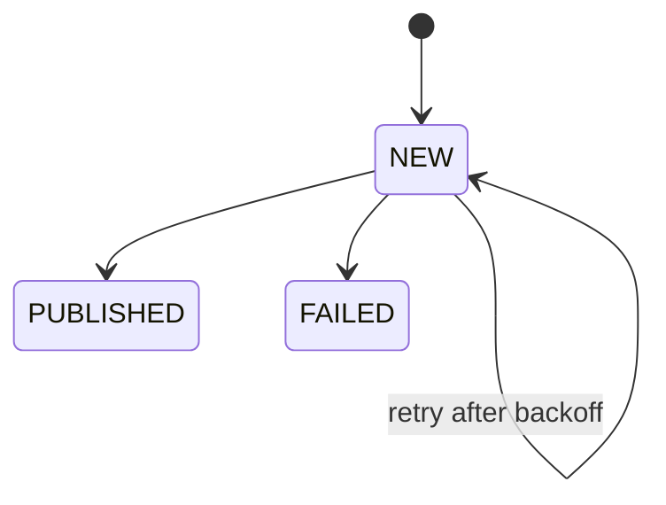

The relay processes events in batches:

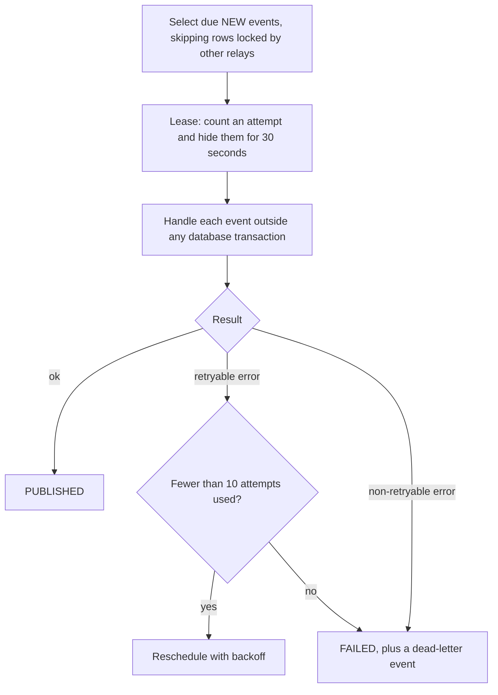

Delivery is **at least once**. If a relay dies, the lease expires and another relay takes the event, so every receiver must tolerate duplicates. State-changed events carry a deterministic event identifier so downstream consumers can deduplicate. A dead-letter event that itself fails does not create another dead letter.

### Drain

To drain is to repeat a processing pass until there is nothing left to do, instead of doing one pass.

| Operation           | What it does                                                                                                                                          |
| ------------------- | ----------------------------------------------------------------------------------------------------------------------------------------------------- |
| Relay: run once     | One batch of outbox events, optionally limited to some event types.                                                                                   |
| Relay: drain        | Repeats the batch until a pass claims nothing, with a cap on the number of passes. Limiting by type lets broadcast requests skip past a long backlog. |
| Inbox: process due  | One pass over pending events whose retry time has come. Used by the inbox worker.                                                                     |
| Inbox: drain parked | Retries every pending event regardless of schedule, repeating while a pass applied something. Triggered right after any event is applied.             |

### Workers

Three loops run inside the service. A loop never overlaps with itself, a failed pass is logged and the loop continues, and on shutdown the pass in flight is allowed to finish.

| Worker    | Work                                       | Cadence     |
| --------- | ------------------------------------------ | ----------- |
| Inbox     | Process due pending events                 | About 1 s   |
| Outbox    | Drain state-changed and dead-letter events | About 0.5 s |
| Broadcast | Drain broadcast requests only              | About 0.2 s |

The broadcast loop starts only when a real submitter has been registered. Otherwise broadcast requests wait safely in the outbox and a warning is logged.

### Dead-letter queue

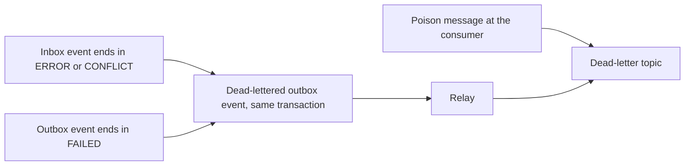

- Messages that are broken at the consumer are published directly, because no inbox row exists yet.
- Inbox and outbox failures go through the outbox, so a failure is never recorded without its dead letter, and a dead letter is never sent for a failure that was rolled back.
- Each dead letter carries the original payload, the original key, the origin (consumer, inbox or outbox), the reason, the number of attempts and, for consumer failures, where the message came from (topic, partition, offset).
- Each event identifier produces at most one dead letter.

### Idempotency, layer by layer

| Layer            | Mechanism                                                                   | What it prevents                                                       |
| ---------------- | --------------------------------------------------------------------------- | ---------------------------------------------------------------------- |
| Consumer, inbox  | Unique event identifier, payload comparison                                 | Redelivered messages, and the same identifier with different content   |
| State machine    | DUPLICATE and STALE decisions                                               | A different message that targets a state already applied               |
| Posting          | Deterministic token per posting, unique, content compared when it is reused | Writing the same entry twice                                           |
| Transaction hash | Write-once                                                                  | Attaching a different hash to a transaction                            |
| Outbox           | Unique per subject, type, state and attempt                                 | Producing the same event twice                                         |
| Broadcast        | Skips a transaction that already has a hash or has already been closed      | Sending a transaction to the chain twice, or after funds were returned |

### Concurrency and locking

Each message is processed in exactly one database transaction. To keep concurrent workers from deadlocking, locks are always taken in the same order:

1. Lock the journal transactions of the request, in ascending identifier order (compared numerically).
2. Read the current state only after the lock is held.
3. Plan the postings. This is a pure computation with no database access.
4. Collect every book the plan touches, lock them once in ascending order, then write.

Two workers handling the same message end up serialized on the lock, and the second one sees the first one's result. Hot books (an omnibus wallet, a fee account) are serialized by design.

## Consistency checks

- **Input validation.** Supported transaction types and states, unique tokens, positive integer quantities, internal accounts for senders, and a sender and a fee sharing a token only when they belong to the same account.
- **Amounts between steps.** The amount in each message must equal what the JT holds. The real fee must not exceed the estimate.
- **Conservation on the instruction.** For every asset present on the recipient side, the senders must send exactly what the recipients receive. An asset that appears only on the sender side (such as the fee asset) is unconstrained. Closing messages are never blocked by this check.
- **Conservation on the ledger.** After an advancing chain event is applied, the amount that left the senders must equal what was credited to internal recipients plus what the event says went to external recipients, per asset type. A mismatch rolls the whole event back.
- **What is deliberately not checked.** A wrong split between recipients when the total is right. The chain is the source of truth for what was actually paid.

## Failure catalogue

### Business failures

| Failure                                       | Behavior                                                                                                                                 | Outcome                                           |
| --------------------------------------------- | ---------------------------------------------------------------------------------------------------------------------------------------- | ------------------------------------------------- |
| Insufficient balance at authorization         | The whole message rolls back. Nothing is created. This is a business error, not an automatic rejection.                                  | Inbox error and dead letter. Upstream must react  |
| Upstream rejects before sending               | Pair reversal from the current book back to the available book, for amount and fee.                                                      | Journal state rejected                            |
| Chain reports failure before it was mined     | Same reversal. No fee was spent, so the full fee is returned.                                                                            | Journal state failed                              |
| Chain reports failure after it was mined      | Amount and estimated fee are returned, then the real fee is charged from the payer's available book to the external book.                | Journal state failed                              |
| Real fee above the estimate                   | The event is refused.                                                                                                                    | Inbox error and dead letter                       |
| Failure reported after confirmation           | Invalid transition. A confirmed transaction is never closed.                                                                             | Inbox error and dead letter                       |
| Broadcast rejected for good                   | See the sequence below.                                                                                                                  | Journal state failed, funds returned              |
| Broadcast fails in an uncertain way (timeout) | The withdrawal is not closed, because the transaction may be on the chain. The relay retries. When retries run out the outbox row fails. | Funds stay in "sent"; dead letter; needs a person |

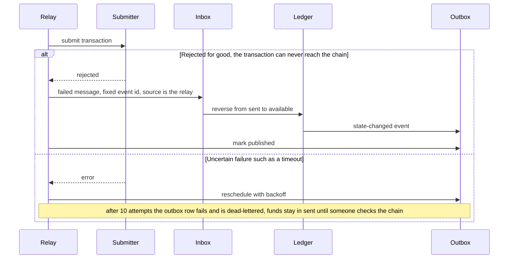

The submitter must be idempotent per instruction (the same transaction yields the same hash), and may only report a rejection when the transaction can never be on the chain. Reporting a rejection for an ambiguous case would return the funds while the transaction might still confirm.

### Messages, ordering and duplicates

| Situation                                      | Behavior                                                                                  |
| ---------------------------------------------- | ----------------------------------------------------------------------------------------- |
| Same event delivered again                     | Delivery is counted, nothing is processed again.                                          |
| Same event identifier, different payload       | Refused as a conflict, the original is untouched, dead letter.                            |
| Same state reported again under a new event id | DUPLICATE decision, nothing written. Chains repeat "confirming" for every block.          |
| Event for a state that was already passed      | STALE decision, nothing written.                                                          |
| Event arrives before its predecessor           | Parked, applied when the predecessor arrives.                                             |
| "Confirmed" arrives while still "sent"         | Catch-up: the implied "confirming" step is applied first.                                 |
| Chain event arrives before the hash is stored  | Matched through the sender or fee token and parked. It is never treated as a new deposit. |
| Broken, unroutable or id-less message          | Dead-lettered at the consumer, then acknowledged.                                         |

### Infrastructure failures

| Failure                                    | Behavior                                                                                                                                                      |
| ------------------------------------------ | ------------------------------------------------------------------------------------------------------------------------------------------------------------- |
| Crash while applying a message             | The transaction rolls back and the event stays PENDING. Reprocessing produces the same tokens, so it is safe.                                                 |
| Crash after commit, before acknowledgement | Kafka redelivers and the inbox deduplicates.                                                                                                                  |
| Database unavailable at the consumer       | The message is not acknowledged and is redelivered.                                                                                                           |
| Deadlock or lock timeout                   | Treated as transient: retried with exponential backoff, up to 20 attempts.                                                                                    |
| Relay crashes after claiming events        | The lease expires and another relay takes them. Receivers tolerate the duplicate.                                                                             |
| Kafka unavailable for publishing           | Outbox events are rescheduled with backoff. After 10 attempts they fail and are dead-lettered.                                                                |
| Dead-letter topic unavailable              | At the consumer the message is not acknowledged. In the outbox the dead-letter event fails visibly in the table without creating further dead letters.        |
| No submitter registered                    | The broadcast loop does not start. Broadcast requests wait in the outbox, with a warning.                                                                     |
| Shutdown signal                            | The consumer stops, workers finish their current pass, the producer disconnects, the database closes. A forced exit follows if this exceeds the grace period. |

### Data integrity failures

| Failure                                                           | Behavior                                                             |
| ----------------------------------------------------------------- | -------------------------------------------------------------------- |
| An amount in a message differs from what the JT holds             | Refused, inbox error and dead letter.                                |
| Conservation violated after applying a chain event                | The whole event rolls back, inbox error and dead letter.             |
| A different transaction hash for a JT that already has one        | Refused as a conflict. A changed hash means a changed payload.       |
| A posting token reused with different content                     | Refused as a conflict instead of silently returning the old posting. |
| A sender and a fee share a token but belong to different accounts | Rejected during validation.                                          |

## Data model

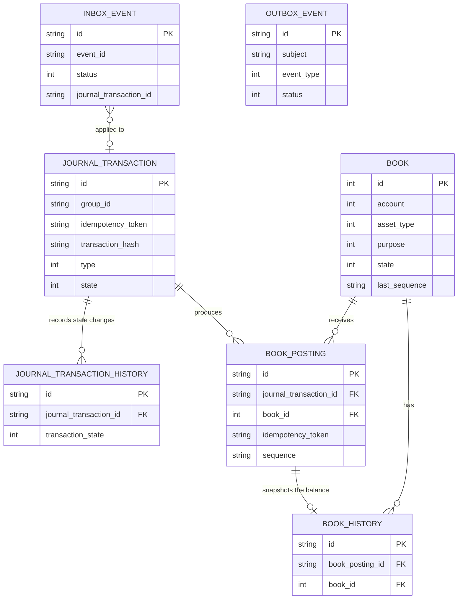

| Entity                      | Purpose                                                                                                                 |
| --------------------------- | ----------------------------------------------------------------------------------------------------------------------- |
| Journal transaction         | One account's side of a transaction, with its group identifier, unique token and optional transaction hash.             |
| Journal transaction history | Append-only state changes. The latest row is the current state.                                                         |
| Book                        | A pot of value, unique per client, account, asset type, wallet type, purpose and state. The external book has no state. |
| Book posting                | Immutable ledger line with a per-book sequence number and a deterministic idempotency token.                            |
| Book history                | The book balance after each posting, so any balance can be audited.                                                     |
| Inbox event                 | Every received message, its status, redelivery count, attempts and, once applied, the journal transaction it affected.  |
| Outbox event                | Every outgoing event with its status, attempts and next attempt time. Its subject identifies what it is about.          |

Large identifiers and sequence numbers are 64-bit in the database and are handled as strings in the application, so they never lose precision. Money amounts are arbitrary-precision integers and are computed with big integers.

## Design decisions

| Decision                                               | Reason                                                                                                                |
| ------------------------------------------------------ | --------------------------------------------------------------------------------------------------------------------- |
| Inbox in front of all handlers                         | Deduplication, ordering tolerance and retries in one place, with no code path that bypasses them.                     |
| Outbox in the same transaction as the ledger entries   | A published event always corresponds to committed state, and a committed change always produces its event.            |
| Pair reversal for failures                             | Derived from what the transaction actually holds, so it is correct from any state and works for any transaction type. |
| Stepwise reversal is not used                          | It would be a revert, which is a different operation, and it would cost many more postings and locks.                 |
| Fee settled on confirmation                            | The real fee is only known at the end. The unspent estimate is returned to the payer.                                 |
| Normalize chains before the ledger                     | One contract for every chain. A new chain needs an adapter, not a ledger change.                                      |
| Conservation checked on postings, not only on payloads | It validates what the ledger actually did, so it also catches defects in the ledger's own request building.           |
| Hash is write-once                                     | A changed hash means the payload changed, which must never be absorbed silently.                                      |
| Broadcast through the outbox                           | The ledger commit and the intent to send are atomic. The network call happens outside any transaction.                |
| Dead letters through the outbox                        | The failure record and the dead letter commit together.                                                               |
| 64-bit identifiers as strings                          | No precision limit, and safe to serialize.                                                                            |
| Defaults for every port                                | The service always starts. Missing real implementations degrade visibly instead of failing the dependency graph.      |

## Operating the system

Signals worth watching:

- Inbox events in error or conflict, and the dead-letter topic itself.
- Outbox events in failed.
- The age of parked events.
- Withdrawals that stay in the "sent" state for longer than the chain normally needs.
- Redelivery counts that grow abnormally for a producer.

Recovery model: find and fix the cause first (usually upstream data), then return the inbox or outbox row to its pending state so the workers process it again. There is no automated tool for this yet. A broadcast request must only be retried after confirming that the transaction is not on the chain. A dead letter is sent at most once per event identifier, so retrying and failing again does not produce another dead letter.

## Known limitations

- Replay, revert and adjustment are not implemented. The attempt counter in posting tokens is reserved for them.
- Stake, unstake and restake have identifiers but no flows.
- There is no real blockchain submitter. The port, its defaults and its contract are in place.
- There is no automated re-drive tool for dead-lettered events.
- There is no reconciliation job (book balances against postings, system-wide zero balance) and no retention job for inbox and outbox rows.
- There are no metrics, alerts or structured logging.
- The conservation checks assume the account model, which is why chain adapters must normalize UTXO chains.
- Hot books limit the throughput of the accounts that touch them.
